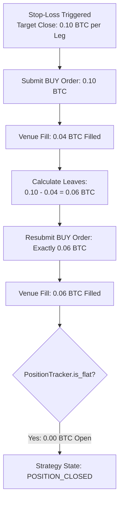

# BTC Options Short Straddle Trading System

[](https://www.python.org/)
[](https://nautilustrader.io/)
[](https://testnet.bybit.com)
[]()
[]()

An institutional-grade, delta-neutral algorithmic trading engine built on **NautilusTrader 1.231.0** for executing and managing Bitcoin (BTC) short straddle options strategies on the **Bybit Testnet**.

---

## 1. Project Introduction

The **BTC Options Short Straddle Trading System** is an institutional-grade algorithmic trading platform designed to automate the discovery, selection, execution, and risk management of dual-leg options straddles. 

Operating on high-performance native Rust and Cython execution kernels wrapped in a clean, typed Python architecture, the engine streams real-time market data from Bybit Testnet, identifies At-The-Money (ATM) strikes, submits paired SELL orders, and autonomously liquidates positions upon encountering Stop-Loss (+1.0%) or Take-Profit (-2.0%) thresholds.

---

## 2. Assignment Objective

Developed for the **Mernplus Technologies BTC Options Straddle Assignment**, this platform demonstrates:
1. **Production-Grade Engineering**: Strict separation of configuration, exchange interfaces, order management, position accounting, and risk monitoring.
2. **Deterministic Dual-Leg Execution**: Invariant-enforced order execution ensuring that order submission never assumes fill execution, and orphan legs are immediately neutralized.
3. **Continuous Risk Oversight**: Real-time valuation strictly driven by **ask-side buyback quotes** (the true cost of liquidating short liabilities).
4. **Resilient Liquidation Engine**: Automated offsetting BUY execution with leaves reconciliation to handle partial fills and venue rejections without human delay.

---

## 3. Strategy Explanation

A **Short Straddle** is a market-neutral options strategy created by simultaneously selling a Call option and a Put option with the **identical strike price ($K$)** and **identical expiration date ($T$)**:

$$\text{Short Straddle} = \text{SELL 1 Call}(K, T) + \text{SELL 1 Put}(K, T)$$

```
Profit / Loss ($)
      ^
      |          /\  (Max Profit = Net Premium Collected)
      |         /  \
  ----+--------/----\--------> Underlying BTC Price ($)
      |       /  |   \
      |      /   K    \
      |     /          \
      |    / (Loss)     \ (Loss)
      v
```

### Strategy Characteristics
- **Delta Neutral ($\Delta \approx 0.00$)**: Near-zero directional bias at market entry.
- **Positive Theta ($\Theta > 0$)**: Positions profit continuously from the natural decay of extrinsic option value over time.
- **Negative Vega ($\nu < 0$)**: Positions profit from drops in implied volatility (IV crush).
- **Asymmetric Risk Profile**: Maximum gain is capped at the premium collected; loss is theoretically unbounded if the underlying moves violently without risk controls.
- **Level 2 Automated Risk Management**: Eliminates catastrophic tail risk by liquidating both legs whenever the combined buyback liability reaches **+1.0% Stop-Loss** or **-2.0% Take-Profit**.

---

## 4. Architecture Diagram

```mermaid
graph TD
    subgraph Exchange ["Bybit Testnet Cloud"]
        REST["REST API /v5/market/instruments-info"]
        WS_Linear["WebSocket /v5/public/linear (Spot/Perp)"]
        WS_Option["WebSocket /v5/public/option (Options)"]
        MatchingEngine["Bybit Matching Engine"]
    end

    subgraph NT_Kernel ["NautilusTrader 1.231.0 Kernel (Rust/Cython)"]
        TradingNode["TradingNode"]
        DataEngine["DataEngine / MessageBus"]
        ExecEngine["ExecEngine"]
        LiveClock["LiveClock"]
    end

    subgraph Strategy_Engine ["Straddle Trading Engine"]
        Discovery["BtcOptionsDiscoveryService<br/>(exchange/instrument_discovery.py)"]
        Selector["InstrumentSelector<br/>(strategy/instrument_selector.py)"]
        MarketData["MarketDataManager<br/>(exchange/market_data.py)"]
        OrderMgr["OrderManager<br/>(strategy/order_manager.py)"]
        PosTracker["PositionTracker<br/>(strategy/position_tracker.py)"]
        RiskMgr["RiskManager<br/>(strategy/risk_manager.py)"]
        Calc["StraddleCalculator<br/>(utils/calculations.py)"]
        Strategy["BtcShortStraddleStrategy<br/>(strategy/straddle_strategy.py)"]
    end

    REST -->|Query Active Chain| Discovery
    WS_Linear -->|Underlying QuoteTicks| DataEngine
    WS_Option -->|Options QuoteTicks| DataEngine
    Discovery -->|758 Active Options| Strategy
    DataEngine -->|QuoteTicks| Strategy
    Strategy -->|Solve min |K - S|| Selector
    Strategy -->|Validate Freshness| MarketData
    Strategy -->|Dual SELL Orders| OrderMgr
    OrderMgr -->|OrderFactory Limit Orders| ExecEngine
    ExecEngine -->|SubmitOrder Messages| MatchingEngine
    MatchingEngine -->|OrderAccepted / OrderFilled| ExecEngine
    ExecEngine -->|Fill Events| Strategy
    Strategy -->|Apply Executed Fills| PosTracker
    PosTracker -->|Position Snapshot| RiskMgr
    RiskMgr -->|Evaluate Buyback vs SL/TP| Calc
    RiskMgr -->|Auto Liquidate on Breach| OrderMgr
    OrderMgr -->|Offsetting BUY Orders| ExecEngine
```

---

## 5. Technology Stack

- **Core Framework**: [NautilusTrader 1.231.0](https://github.com/nautechsystems/nautilus_trader) (Rust/Cython algorithmic trading platform)
- **Language / Runtime**: Python 3.13.7 (64-bit)
- **Configuration & Validation**: [Pydantic 2.14](https://docs.pydantic.dev/) & `pydantic-settings` (with `SecretStr` security guards)
- **Mathematical Precision**: Python `decimal.Decimal` (Fixed-precision financial arithmetic)
- **Data & Serialization**: `msgspec 0.22`, `pyarrow 26.0`, `pandas 3.1`
- **Testing Framework**: `pytest 9.2` & `pytest-mock 3.17`
- **Exchange Integration**: Bybit API V5 (Linear Spot/Perpetual + USDC/USDT Options)

---

## 6. Installation

### Prerequisites
- Windows 11 (64-bit), macOS, or Linux.
- Python 3.13 (64-bit) installed and on `PATH`.
- Git 2.40+.

### Step-by-Step Setup

```powershell
# 1. Clone repository
git clone https://github.com/mernplus/btc-options-straddle.git
cd btc-options-straddle

# 2. Create Python virtual environment
python -m venv .venv

# 3. Activate virtual environment
# Windows PowerShell:
.\.venv\Scripts\Activate.ps1
# Linux / macOS:
# source .venv/bin/activate

# 4. Upgrade pip and install dependencies
python -m pip install --upgrade pip
pip install -r requirements.txt
```

---

## 7. Configuration

All configuration is managed defensively via environment variables and parsed with `config/settings.py`.

### Create `.env` File
Copy the provided template:
```powershell
cp .env.example .env
```

### Key Configuration Parameters
| Parameter | Default | Description |
| :--- | :---: | :--- |
| `ENVIRONMENT` | `testnet` | Target environment. (`production` is **hard-blocked**). |
| `BYBIT_TESTNET` | `true` | Must be `true`. Disabling raises a fatal `SecurityError`. |
| `TRADING_MODE` | `DRY_RUN` | Options: `DRY_RUN` (simulated orders) or `PAPER` (live Testnet execution). |
| `ORDER_QUANTITY` | `0.1` | BTC order quantity per option leg (Minimum: $0.01$ BTC). |
| `STOP_LOSS_PERCENT` | `1.0` | Stop-loss threshold (+1.0% liability rise). |
| `TAKE_PROFIT_PERCENT` | `2.0` | Take-profit threshold (-2.0% liability drop). |
| `MAX_QUOTE_AGE_SECONDS`| `5.0` | Maximum age of quotes before being considered stale. |
| `UNMATCHED_LEG_POLICY` | `CANCEL_AND_CLOSE`| Policy when one leg fills and the opposing leg remains pending. |

---

## 8. Bybit Testnet Setup

1. Register an account at [https://testnet.bybit.com](https://testnet.bybit.com).
2. Claim test funds (USDT/BTC) using the **Testnet Faucet**.
3. Navigate to **Account & Security $\to$ API Management $\to$ Create New Key**.
4. Enable **Read-Write** permissions for:
   - `Contract` (Orders and Positions)
5. Add your credentials to your local `.env`:
   ```env
   BYBIT_API_KEY=your_testnet_key_here
   BYBIT_API_SECRET=your_testnet_secret_here
   TRADING_MODE=PAPER
   ```
*(In `DRY_RUN` mode, credentials are not required; simulated local orders are executed safely).*

---

## 9. How to Run

The platform features dedicated CLI commands via `main.py`:

```powershell
# Check environment and security parameters
python main.py --config-check

# Verify live WebSocket handshake with Bybit Testnet
python main.py --connectivity-check

# Discover active BTC options contracts on Bybit Testnet
python main.py --discover-options

# Calculate and select the nearest ATM straddle pair based on live spot price
python main.py --select-straddle

# Run live market data diagnostic stream (12 seconds)
python main.py --subscribe-quotes

# Run Order Management state machine & orphan leg recovery diagnostic
python main.py --test-order-manager

# Run all 8 deterministic Level 2 simulation scenarios
python main.py --level2-simulations

# Execute the complete 13-requirement Level 2 strategy demonstration in DRY_RUN
python main.py --level2-dry-run

# Execute controlled Level 2 on Bybit Testnet (requires explicit confirmation)
python main.py --level2-testnet
```

---

## 10. How to Test

Run the complete 113-test automated test suite:

```powershell
python -m pytest
```

Run specific test modules:
```powershell
# Level 2 Strategy Integration & Simulations
python -m pytest tests/test_level2_integration.py -v

# Automated Exit Execution & Leaves Reconciliation
python -m pytest tests/test_exit_execution.py -v

# Automated Risk Manager & Threshold Triggers
python -m pytest tests/test_risk_manager.py -v

# High-Precision Premium Calculations
python -m pytest tests/test_calculations.py -v

# Dual-Leg Order Manager & State Machine
python -m pytest tests/test_order_manager.py -v
```

---

## 11. Level 1 Functionality

Level 1 establishes the complete dual-leg short entry pipeline:
1. **TradingNode Lifecycle**: Proper startup, event loop binding, and clock resolution.
2. **Options Discovery**: Automatic parsing of Bybit options metadata (multipliers, minimum quantities, tick sizes).
3. **ATM Selection**: Mathematical minimization of $|K - S_{\text{ref}}|$ with deterministic tie-breaking.
4. **Independent Leg Tracking**: 7-state finite state machine per leg (`NOT_SUBMITTED`, `SUBMITTED`, `ACCEPTED`, `PARTIALLY_FILLED`, `FILLED`, `CANCELED`, `REJECTED`).
5. **Orphan Leg Recognition**: Detects when one leg fills while the opposing leg remains pending, and triggers the configured recovery policy (`CANCEL_AND_CLOSE`).
6. **Ask-Side MtM**: Mark-to-market valuation strictly based on the **Ask price** (the buyback cost).
7. **No Automated SL/TP**: In Level 1, positions remain open for operator oversight.

---

## 12. Level 2 Functionality

Level 2 elevates the system to full closed-loop autonomous risk management:
1. **Dynamic Arming**: Risk monitoring engages only when both entry fills establish a verified two-leg short straddle.
2. **Continuous Liability Valuation**: Evaluates current buyback cost on every validated quote tick.
3. **Automated Stop-Loss**: Emits offsetting BUY orders when buyback value reaches or exceeds **+1.0%** of entry premium.
4. **Automated Take-Profit**: Emits offsetting BUY orders when buyback value drops to or below **-2.0%** of entry premium.
5. **6-State Exit Machine**: Transitions through `OPEN` $\to$ `EXIT_TRIGGERED` $\to$ `EXIT_ORDERS_SUBMITTED` $\to$ `EXIT_PARTIALLY_FILLED` $\to$ `EXIT_COMPLETED` (or `EXIT_FAILED`).
6. **Leaves Reconciliation**: Recalculates unfilled residuals and resubmits closing orders until both legs are flat.
7. **Verified Flat Requirement**: The system refuses to claim completion until `PositionTracker.is_flat` confirms $0.00$ open contracts.

---

## 13. Risk Formulas

All formulas are evaluated with high-precision `Decimal` arithmetic in `utils/calculations.py`:

$$\text{ENTRY\_PREMIUM} = (Q_C \times \text{VWAP}_C \times M) + (Q_P \times \text{VWAP}_P \times M)$$
$$\text{SL\_THRESHOLD} = \text{ENTRY\_PREMIUM} \times 1.01 \quad (+1.0\% \text{ liability increase})$$
$$\text{TP\_THRESHOLD} = \text{ENTRY\_PREMIUM} \times 0.98 \quad (-2.0\% \text{ liability decrease})$$
$$\text{CURRENT\_BUYBACK\_VALUE} = (Q_{C,\text{open}} \times \text{ASK}_C \times M) + (Q_{P,\text{open}} \times \text{ASK}_P \times M)$$
$$\text{REALIZED\_PNL} = \text{ENTRY\_PREMIUM} - \text{TOTAL\_EXIT\_COST} - \sum \text{COMMISSIONS}$$

*Where $M = 1.0$ (Contract Multiplier for Bybit linear BTC options).*

---

## 14. Partial-Fill Handling

In real-world options trading, liquidations may fill in multiple tranches across different prices and times:



- **Invariant**: The system **never over-buys or under-buys** relative to actual open short liability.
- **Asymmetric Leg Fills**: If one leg fills completely while the other partially fills, the exit state transitions to `EXIT_PARTIALLY_FILLED` and continues monitoring the open leg until flat.

---

## 15. Example Logs

Excerpt from `python main.py --level2-dry-run`:

```text
=====================================================================================
   MERNPLUS TECHNOLOGIES - LEVEL 2 BTC SHORT STRADDLE STRATEGY DEMONSTRATION
=====================================================================================
[REQ 1/13] Initializing Level 2 Strategy Node & Lifecycle...
           Strategy ID:          BTC-STRADDLE-L2 | Trader ID: STRADDLE-TRADER
           Configured SL%:       1.0% | Configured TP%: 2.0% | Auto Close: True

[REQ 3/13] Ingesting Options Chain & Selecting ATM Straddle Pair...
           Selected ATM Strike:  $70,000.00 (2.00 DTE)
           Call Leg:             BTC-TEST-70000-C-USDT.BYBIT
           Put Leg:              BTC-TEST-70000-P-USDT.BYBIT

[REQ 5/13] Monitoring Venue Acceptances & Execution Fills...
           Call Fill:            0.05 BTC @ $2480.00 VWAP
           Put Fill:             0.05 BTC @ $2480.00 VWAP
           Strategy State:       POSITION_ACTIVE

[REQ 6/13] Calculating Combined Entry Premium & SL/TP Thresholds...
           Combined Premium:     $248.00 USDT
           Stop-Loss (+1.0%):    $250.48 USDT
           Take-Profit (-2.0%):  $243.04 USDT

[REQ 9/13] Ingesting Adverse Market Quotes to Trigger 1% Stop-Loss...
           Adverse Call Ask:     $2520.00 | Adverse Put Ask: $2510.00
           Projected Buyback:    $251.50 USDT >= $250.48 USDT
           [!] STOP-LOSS BREACH TRIGGERED!

[REQ 11/13] Generating & Submitting Automated Offsetting BUY Orders...
            Exit Tracking ID:     EXIT-STRADDLE-1794562680-002-680783
            Call Closing Order:   S-C-562680783-0003-EXIT (0.05 BTC)
            Put Closing Order:    S-P-562680784-0004-EXIT (0.05 BTC)

[REQ 12/13] Handling Partial Closing Executions (Asynchronous Legs)...
            - Leg 1 (Call) fills first (0.05 BTC @ $2,520.00) -> State: EXIT_PARTIALLY_FILLED
            - Leg 2 (Put) fills second (0.05 BTC @ $2,510.00) -> State: EXIT_COMPLETED

[REQ 13/13] Confirming Both Positions Flat & Final Reconciliation...
            Final Strategy State: POSITION_CLOSED
            Call Position:        0.0 BTC (FLAT)
            Put Position:         0.0 BTC (FLAT)
            Realized PnL:         $-3.50 USDT (-1.41%)
```

---

## 16. Known Limitations

1. **Testnet Liquidity Disparities**: Bybit Testnet options often exhibit wide bid-ask spreads or sparse orderbooks compared to mainnet. The engine's quote freshness guard (`MAX_QUOTE_AGE_SECONDS=5.0`) safely drops stale data.
2. **Exchange Portfolio Margin**: The platform calculates gross liability and cash flows; it relies on Bybit's exchange-level risk engine for dynamic margin haircut calculations.
3. **Operational Boundary**: Deterministic simulation and DRY_RUN modes confirm algorithmic correctness. Live Testnet execution requires credentials and explicit confirmation via `python main.py --level2-testnet`.

---

## 17. Troubleshooting

Detailed operational troubleshooting runbooks are available in [`docs/TROUBLESHOOTING.md`](docs/TROUBLESHOOTING.md):
- **Precision Errors**: All prices must be formatted with 2 decimal places (`f"{px:.2f}"`) to avoid NautilusTrader Cython precision mismatches.
- **Clock Synchronization**: Windows clocks must be synchronized via `w32tm /resync` to avoid Bybit `10003` recv_window errors.
- **Credential Masking**: If log inspection is required, verify that `SensitiveDataFilter` masks all keys to `[REDACTED]`.

---

## 18. Future Improvements (Roadmap)

- [ ] **Level 3 Integration**: Dynamic delta-hedging using underlying linear perpetual futures contracts (`BTCUSDT-LINEAR`).
- [ ] **Portfolio Margin Calculator**: Local calculation of SPAN / Portfolio Margin requirements before entry submission.
- [ ] **Volatility Surface Modeling**: Real-time Black-76 implied volatility (IV) fitting using SABR / SVI models.
- [ ] **Multi-Expiry Straddles**: Dynamic expiration selection based on volatility term structure contango / backwardation.

---

## Detailed Documentation Directory

For in-depth architectural and operational guides, see:
- [Architecture Breakdown (`docs/ARCHITECTURE.md`)](docs/ARCHITECTURE.md)
- [Strategy Flow & Lifecycle (`docs/STRATEGY_FLOW.md`)](docs/STRATEGY_FLOW.md)
- [Risk Management & Math (`docs/RISK_MANAGEMENT.md`)](docs/RISK_MANAGEMENT.md)
- [Troubleshooting & Diagnostics (`docs/TROUBLESHOOTING.md`)](docs/TROUBLESHOOTING.md)
- [Full QA Testing & Audit Report (`docs/QA_DEBUGGING_REPORT.md`)](docs/QA_DEBUGGING_REPORT.md)
- [Level 2 Strategy Report (`LEVEL2_REPORT.md`)](LEVEL2_REPORT.md)
- [Level 1 Strategy Report (`LEVEL1_REPORT.md`)](LEVEL1_REPORT.md)
