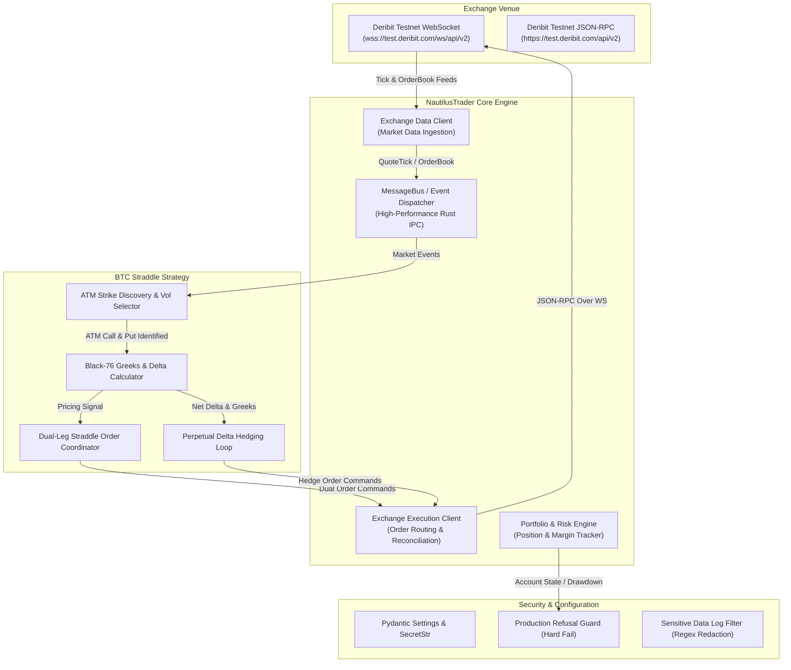

# Technical Requirements Document (TRD)

## Project Information
- **Project**: BTC Options Straddle Trading Engine
- **Assignment**: Mernplus Technologies BTC Options Straddle Project
- **Architecture**: Event-Driven Asynchronous Trading Engine with Rust Core
- **Environment**: Deribit Testnet (Isolated Sandbox)

---

## 1. Technical Stack Architecture



---

## 2. Component Specifications

### 2.1. Language & Runtimes
- **Python Runtime**: Python 3.13.7 (64-bit). Chosen for zero GIL regressions, robust modern C-API compatibility, and verified binary wheel availability on Windows 11.
- **Trading Engine Framework**: `nautilus_trader==1.231.0`. Provides zero-copy data structures, Cython/Rust event loops, and microsecond-level order routing.
- **Configuration & Validation**: `pydantic>=2.10.0` and `pydantic-settings>=2.7.0`.
- **Numerical Computation**: `numpy>=1.26.4`, `pandas>=2.2.0`, `pyarrow>=17.0.0`.
- **Testing**: `pytest>=8.3.0`, `pytest-mock>=3.14.0`.

---

## 3. Deribit Testnet API Integration Protocol

### 3.1. Transport Protocols
- **Primary Data & Execution**: WebSocket connection (`wss://test.deribit.com/ws/api/v2`). Full-duplex JSON-RPC 2.0 streaming.
- **Auxiliary HTTP**: REST endpoints (`https://test.deribit.com/api/v2`) for initial instrument universe bootstrapping and network diagnostics.

### 3.2. Authentication Protocol (Non-Exposing)
- Authenticates via JSON-RPC method `public/auth` using `client_credentials` grant type.
- Never sends credentials in cleartext URLs; only uses WebSocket payload parameters.
- Re-authenticates automatically before token expiration using refresh tokens.

### 3.3. Key WebSocket Channels
1. **Instrument Discovery**: `public/get_instruments?currency=BTC&kind=option&expired=false`
2. **Index / Underlying Price**: `ticker.btc_usd.raw` or `deribit_price_index.btc_usd`
3. **ATM Option Order Books**: `book.{instrument_name}.none.10.100ms`
4. **Hedge Instrument Book**: `book.BTC-PERPETUAL.none.10.100ms`
5. **Private User Execution Stream**: `user.orders.{kind}.raw` and `user.portfolio.btc`

---

## 4. Mathematical Modeling & Greeks Computation

### 4.1. Pricing Model
Options pricing implemented via the **Black-76 Model** (standard for European futures-style options traded on Deribit):

$$d_1 = \frac{\ln(F / K) + (\sigma^2 / 2)T}{\sigma \sqrt{T}}$$

$$d_2 = d_1 - \sigma \sqrt{T}$$

$$\text{Call Price} = e^{-rT} [F \cdot N(d_1) - K \cdot N(d_2)]$$

$$\text{Put Price} = e^{-rT} [K \cdot N(-d_2) - F \cdot N(-d_1)]$$

Where:
- $F$: Forward price (Deribit BTC synthetic future / index for expiry $T$).
- $K$: Strike price.
- $T$: Time to maturity in annualized years.
- $\sigma$: Implied volatility.
- $r$: Annualized risk-free interest rate (configured via `RISK_FREE_RATE`).

### 4.2. Greeks Formulas
- **Delta ($\Delta$)**:
  $$\Delta_{\text{call}} = e^{-rT} N(d_1), \quad \Delta_{\text{put}} = -e^{-rT} N(-d_1)$$
- **Gamma ($\Gamma$)**:
  $$\Gamma = \frac{e^{-rT} N'(d_1)}{F \sigma \sqrt{T}}$$
- **Vega ($\mathcal{V}$)**:
  $$\mathcal{V} = F e^{-rT} N'(d_1) \sqrt{T} \times 0.01$$
- **Theta ($\Theta$)**:
  $$\Theta_{\text{call}} = -\frac{F e^{-rT} N'(d_1) \sigma}{2\sqrt{T}} + r F e^{-rT} N(d_1) - r K e^{-rT} N(d_2)$$

---

## 5. Security & Risk Gates Architecture

### 5.1. Hard Failure Safeguards
```python
# Enforcement in config/settings.py
if ENVIRONMENT in ("production", "prod", "mainnet", "live"):
    raise SecurityError("CRITICAL: Production trading strictly forbidden.")
if not DERIBIT_TESTNET:
    raise SecurityError("CRITICAL: DERIBIT_TESTNET flag must be True.")
```

### 5.2. Memory & Secret Isolation
- `DERIBIT_CLIENT_ID` and `DERIBIT_CLIENT_SECRET` are strictly typed as `pydantic.SecretStr`.
- Custom `SensitiveDataFilter` scrubs patterns matching API keys, passwords, and tokens before log emission.
- `.env` is omitted from Git via `.gitignore`.

### 5.3. Execution Modes
- **`DRY_RUN`**: Orders, fills, and portfolio positions are simulated entirely in-memory with zero exchange order placement.
- **`PAPER`**: Routed to Deribit Testnet with test credentials and fake testnet BTC balances.
- **`LIVE`**: Permanently blocked at the architecture level.

---

## 6. Fault Tolerance & Network Resilience

1. **Heartbeat Monitoring**: Deribit WebSocket requires heartbeat (`public/set_heartbeat` with 30s interval). Unacknowledged heartbeats trigger reconnection.
2. **Reconnection & State Resynchronization**:
   - Backoff strategy: Exponential backoff with jitter ($1\text{s}, 2\text{s}, 4\text{s}, \dots, \max 30\text{s}$).
   - On reconnect: Subscriptions re-established $\rightarrow$ Open orders queried $\rightarrow$ Fills reconciled $\rightarrow$ Hedging loop re-armed.
3. **Execution Failsafes (Orphan Leg Prevention)**:
   - If Call order fills but Put order rejects, the engine immediately cancels or covers the orphan leg, preventing accidental directional exposure.
