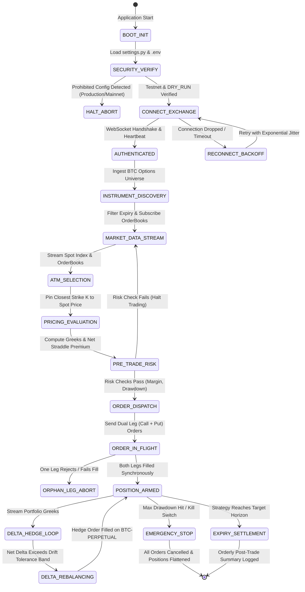

# App Flow Document: BTC Options Straddle Lifecycle

## Project Information
- **Project**: BTC Options Straddle Trading Engine
- **Assignment**: Mernplus Technologies BTC Options Straddle Project
- **Workflow Scope**: Complete State Machine & Execution Journey

---

## 1. High-Level Engine State Machine

---

## 2. Detailed Execution Steps & Decision Paths

### Step 1: Bootstrapping & Security Gate
- **Action**: `main.py` invokes `get_settings()` from `config/settings.py`.
- **Validation**:
  - `ENVIRONMENT` strictly equals `"testnet"`, `"development"`, or `"test"`.
  - `DERIBIT_TESTNET` is `True`.
  - `TRADING_MODE` is either `"DRY_RUN"` or `"PAPER"`.
- **Error State**: If `ENVIRONMENT="production"`, raise `SecurityError` and exit with code 2.

### Step 2: Testnet Connection & Handshake
- **Action**: Initializes WebSocket connection to `wss://test.deribit.com/ws/api/v2`.
- **Handshake**:
  - Sends `public/set_heartbeat` with 30-second interval.
  - Sends `public/auth` using client ID and client secret.
- **Error State**:
  - Socket disconnect triggers reconnection loop with exponential backoff ($1\text{s}, 2\text{s}, 4\text{s}, \dots, \max 30\text{s}$).

### Step 3: Instrument Discovery & Filtering
- **Action**: Queries `public/get_instruments?currency=BTC&kind=option&expired=false`.
- **Filtering Logic**:
  - Filters by desired expiration (e.g., target expiry date matching 08:00 UTC cycle).
  - Collects pair sets: `BTC-{EXPIRY}-{STRIKE}-C` (Call) and `BTC-{EXPIRY}-{STRIKE}-P` (Put).

### Step 4: Market Data Ingestion & ATM Selection
- **Action**: Subscribes to `deribit_price_index.btc_usd` and `book.{instrument}.none.10.100ms`.
- **ATM Algorithm**:
  $$\text{ATM Strike } K^* = \arg\min_{K} |K - S_{\text{index}}|$$
- **Verification**: Verifies that both $K^*$ Call and $K^*$ Put order books have top-of-book liquidity (bid/ask non-zero and spread within acceptable limits).

### Step 5: Pre-Trade Risk Check
- **Checks**:
  1. Has the maximum drawdown threshold (`MAX_DRAWDOWN_PCT`, default 5.0%) been violated?
  2. Does the projected margin exceed the maximum allowed maintenance margin (70%)?
  3. Are there duplicate active orders already in flight?
- **Decision**: If any check fails, log warning and suppress order dispatch.

### Step 6: Dual-Leg Order Routing & Synchronous Execution
- **Action**: Concurrently submits:
  - Leg 1: BUY `BTC-{EXPIRY}-{K^*}-C` (Quantity: `BTC_STRADDLE_QUANTITY`)
  - Leg 2: BUY `BTC-{EXPIRY}-{K^*}-P` (Quantity: `BTC_STRADDLE_QUANTITY`)
- **TIF (Time-In-Force)**: Limit order at mid-price with short timeout or IOC (Immediate-or-Cancel).
- **Orphan Leg Protection**:
  - If Leg 1 fills but Leg 2 times out or rejects, the engine immediately submits an offsetting market order for Leg 1 to eliminate naked directional exposure.

### Step 7: Continuous Delta-Neutral Hedging Loop
- **Trigger**: Every new market quote tick or at periodic intervals (1 second).
- **Calculation**:
  $$\Delta_{\text{net}} = \sum (\Delta_{\text{call}} \cdot Q_{\text{call}}) + \sum (\Delta_{\text{put}} \cdot Q_{\text{put}}) + Q_{\text{hedge}}$$
- **Hedging Decision**:
  - If $|\Delta_{\text{net}}| > \delta_{\text{tolerance}}$ (e.g. $0.05\text{ BTC}$):
    - Compute required hedge order size: $Q^* = -\Delta_{\text{net}}$.
    - Dispatch market/aggressive limit order on `BTC-PERPETUAL`.

### Step 8: Risk Exit & Strategy Teardown
- **Triggers**:
  - **Stop-Loss**: Portfolio unrealized loss $\ge \text{MAX\_DRAWDOWN\_PCT}$.
  - **Take-Profit / Volatility Collapse**: Target PnL reached.
  - **Time Decay / Expiry**: 30 minutes before option expiration to avoid delivery pin risk.
  - **Emergency Kill Switch**: Terminal signal (`SIGINT` / `Ctrl+C`).
- **Action**:
  - Cancels all resting open orders.
  - Closes Call, Put, and Perpetual positions.
  - Generates post-trade report in `logs/straddle_engine.log`.
