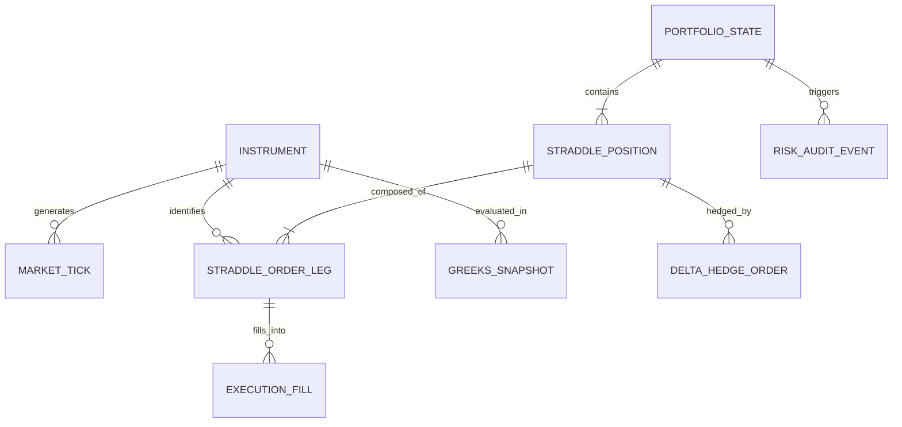

# Backend Schema & Data Model Document

## Project Information
- **Project**: BTC Options Straddle Trading Engine
- **Assignment**: Mernplus Technologies BTC Options Straddle Project
- **Data Layers**: In-Memory Zero-Copy Models (NautilusTrader Rust/Cython), Parquet Time-Series Storage (PyArrow), Audit Log Stores

---

## 1. Entity Relationship & Data Flow Model

---

## 2. In-Memory & Persistence Schema Specifications

### 2.1. Table/Entity: `instruments`
Stores catalog metadata for all discoverable Deribit instruments.

| Field Name | Type | Constraints | Description |
| :--- | :--- | :--- | :--- |
| `instrument_id` | `VARCHAR(64)` | PRIMARY KEY | Nautilus unique identifier (e.g., `BTC-28NOV26-88500-C.DERIBIT`) |
| `symbol` | `VARCHAR(32)` | NOT NULL | Native Deribit symbol (e.g., `BTC-28NOV26-88500-C`) |
| `asset_class` | `VARCHAR(16)` | NOT NULL | `OPTION` or `PERPETUAL` |
| `underlying` | `VARCHAR(8)` | NOT NULL | `BTC` |
| `quote_currency`| `VARCHAR(8)` | NOT NULL | `USD` |
| `settlement_currency`| `VARCHAR(8)` | NOT NULL | `BTC` |
| `strike_price` | `DECIMAL(12, 2)` | NULLABLE | Strike in USD (NULL for Perpetuals) |
| `expiration_ts` | `BIGINT` | NULLABLE | Expiry timestamp in nanoseconds UTC |
| `option_type` | `VARCHAR(4)` | NULLABLE | `CALL`, `PUT`, or NULL |
| `tick_size` | `DECIMAL(8, 4)` | NOT NULL | Minimum price increment (e.g., `0.0005 BTC`) |
| `lot_size` | `DECIMAL(8, 4)` | NOT NULL | Minimum contract size (e.g., `0.1 BTC`) |
| `is_active` | `BOOLEAN` | NOT NULL | Flag indicating if currently tradeable |

---

### 2.2. Table/Entity: `market_ticks`
Streaming time-series ticks recorded for research, pricing, and backtest replay.

| Field Name | Type | Constraints | Description |
| :--- | :--- | :--- | :--- |
| `tick_id` | `BIGINT` | PRIMARY KEY, AUTO | Monotonic tick identifier |
| `instrument_id` | `VARCHAR(64)` | NOT NULL, INDEX | Foreign key to `instruments` |
| `timestamp_ns` | `BIGINT` | NOT NULL, INDEX | UNIX timestamp in nanoseconds |
| `bid_price` | `DECIMAL(12, 4)` | NOT NULL | Best bid in quote currency (or BTC) |
| `ask_price` | `DECIMAL(12, 4)` | NOT NULL | Best ask in quote currency (or BTC) |
| `bid_size` | `DECIMAL(10, 4)` | NOT NULL | Available size at best bid |
| `ask_size` | `DECIMAL(10, 4)` | NOT NULL | Available size at best ask |
| `index_price` | `DECIMAL(12, 2)` | NOT NULL | Underlying spot index price at tick time |

---

### 2.3. Table/Entity: `greeks_snapshots`
Computed volatility surface and analytical values per option.

| Field Name | Type | Constraints | Description |
| :--- | :--- | :--- | :--- |
| `snapshot_id` | `BIGINT` | PRIMARY KEY, AUTO | Monotonic snapshot ID |
| `instrument_id` | `VARCHAR(64)` | NOT NULL, INDEX | Option instrument reference |
| `timestamp_ns` | `BIGINT` | NOT NULL, INDEX | Calculation timestamp |
| `forward_price` | `DECIMAL(12, 2)` | NOT NULL | Forward price used in pricing engine |
| `implied_vol` | `DECIMAL(6, 4)` | NOT NULL | Calibrated annualized IV (e.g., `0.5842` for 58.42%) |
| `delta` | `DECIMAL(6, 4)` | NOT NULL | Option Delta ($\Delta \in [-1.0, 1.0]$) |
| `gamma` | `DECIMAL(8, 6)` | NOT NULL | Option Gamma ($\Gamma$) |
| `vega` | `DECIMAL(10, 4)` | NOT NULL | Option Vega ($\mathcal{V}$) per 1% vol change |
| `theta` | `DECIMAL(10, 4)` | NOT NULL | Option Theta ($\Theta$) per calendar day |

---

### 2.4. Table/Entity: `straddle_positions`
Tracks active composite straddle strategies and portfolio aggregations.

| Field Name | Type | Constraints | Description |
| :--- | :--- | :--- | :--- |
| `straddle_id` | `VARCHAR(48)` | PRIMARY KEY | Unique straddle instance ID |
| `creation_ts` | `BIGINT` | NOT NULL | Entry timestamp |
| `strike_price` | `DECIMAL(12, 2)` | NOT NULL | Common ATM strike price |
| `expiration_ts` | `BIGINT` | NOT NULL | Option expiration date/time |
| `quantity` | `DECIMAL(8, 4)` | NOT NULL | Position size in BTC |
| `call_instrument_id`| `VARCHAR(64)` | NOT NULL | Foreign key to Call instrument |
| `put_instrument_id` | `VARCHAR(64)` | NOT NULL | Foreign key to Put instrument |
| `entry_call_price` | `DECIMAL(12, 4)` | NOT NULL | Average fill price of Call leg |
| `entry_put_price` | `DECIMAL(12, 4)` | NOT NULL | Average fill price of Put leg |
| `total_premium_paid`| `DECIMAL(12, 4)`| NOT NULL | Total cost basis of the dual legs |
| `net_delta` | `DECIMAL(8, 4)` | NOT NULL | Unhedged delta of Call + Put |
| `status` | `VARCHAR(16)` | NOT NULL | `OPEN`, `HEDGED`, `CLOSED`, `STOPPED_OUT` |

---

### 2.5. Table/Entity: `executions_and_fills`
Audit trail of every filled order leg, slippage metrics, and exchange reference numbers.

| Field Name | Type | Constraints | Description |
| :--- | :--- | :--- | :--- |
| `execution_id` | `VARCHAR(48)` | PRIMARY KEY | Internal unique execution identifier |
| `client_order_id`| `VARCHAR(48)` | NOT NULL, INDEX | Client-assigned idempotency token |
| `exchange_order_id`| `VARCHAR(48)`| NOT NULL | Deribit exchange order ID |
| `instrument_id` | `VARCHAR(64)` | NOT NULL | Instrument traded |
| `side` | `VARCHAR(4)` | NOT NULL | `BUY` or `SELL` |
| `filled_quantity`| `DECIMAL(10, 4)`| NOT NULL | Number of contracts filled |
| `fill_price` | `DECIMAL(12, 4)` | NOT NULL | Executed fill price |
| `commission` | `DECIMAL(10, 6)` | NOT NULL | Trading fee charged by Deribit |
| `slippage_usd` | `DECIMAL(8, 2)` | NOT NULL | Difference between mid-price and fill |
| `timestamp_ns` | `BIGINT` | NOT NULL | Execution completion timestamp |

---

### 2.6. Table/Entity: `risk_audit_events`
Immutable security and risk intervention log.

| Field Name | Type | Constraints | Description |
| :--- | :--- | :--- | :--- |
| `event_id` | `BIGINT` | PRIMARY KEY, AUTO | Log sequence number |
| `timestamp_ns` | `BIGINT` | NOT NULL, INDEX | Event occurrence timestamp |
| `event_type` | `VARCHAR(32)` | NOT NULL | `DRAWDOWN_BREACH`, `KILL_SWITCH`, `ORPHAN_ABORT`, `ENV_REJECT` |
| `severity` | `VARCHAR(12)` | NOT NULL | `WARNING`, `CRITICAL`, `FATAL` |
| `description` | `TEXT` | NOT NULL | Sanitized description of condition and action taken |
| `portfolio_equity`| `DECIMAL(16, 4)`| NOT NULL | Account equity at moment of trigger |
| `margin_ratio` | `DECIMAL(6, 4)` | NOT NULL | Maintenance margin utilization ratio |
