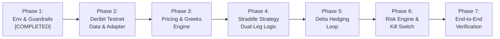

# Master Implementation Plan

## Project Information
- **Project**: BTC Options Straddle Trading Engine
- **Assignment**: Mernplus Technologies BTC Options Straddle Project
- **Methodology**: Test-Driven, Phase-Gated Engineering with NautilusTrader

---

## 1. Phased Roadmap Overview

---

## 2. Phase-by-Phase Breakdown

### Phase 1: Project Initialization & Environment Setup (Status: COMPLETED ✅)
- **Objective**: Establish development environment, verify Python 3.13, install NautilusTrader 1.231.0, construct repository skeleton, and enforce production-refusal security guardrails.
- **Completed Deliverables**:
  - `requirements.txt` with pinned NautilusTrader, Pydantic v2, PyArrow, PyTest.
  - `config/settings.py` with strict production rejection gates.
  - `utils/logger.py` with regex secret redaction.
  - `tests/test_config.py` with 100% passing tests.
  - `main.py` entry point verifying NautilusTrader Rust core.
  - Git repository initialization and clean initial commit.

---

### Phase 2: Deribit Testnet Integration & Market Data Ingestion
- **Objective**: Establish authenticated, resilient WebSocket and JSON-RPC connectivity with Deribit Testnet; stream live BTC index price and options order books.
- **Tasks**:
  1. Build `exchange/deribit_client.py`: Asynchronous WebSocket client with auto-heartbeat, ping/pong, and exponential backoff reconnection.
  2. Implement `exchange/instrument_loader.py`: Queries Deribit option universe, filters by active maturities, and constructs Nautilus `Instrument` definitions.
  3. Build `exchange/data_adapter.py`: Translates raw JSON-RPC book notifications (`book.{instrument}.none.10.100ms`) into Nautilus `OrderBook` and `QuoteTick` events.
- **Testing Gate**:
  - `tests/test_deribit_client.py`: Mocked WebSocket handshake, message parsing, heartbeat verification, and reconnection testing.
- **Exit Criteria**: Live market depth streaming into Nautilus message bus without disconnects or frame drops.

---

### Phase 3: Options Pricing, Volatility Surface & Greeks Calculator
- **Objective**: Implement institutional options mathematics for Black-76 European options pricing and real-time Greek derivation.
- **Tasks**:
  1. Implement `strategy/pricing.py`: Vectorized Black-76 pricing function calculating theoretical call/put prices given $F, K, T, \sigma, r$.
  2. Implement `strategy/greeks.py`: Closed-form analytical Greeks ($\Delta, \Gamma, \mathcal{V}, \Theta$).
  3. Implement `strategy/atm_selector.py`: Dynamic ATM strike finder ($K^* = \arg\min |K - S_{\text{index}}|$) with spread sanity filters.
- **Testing Gate**:
  - `tests/test_pricing.py`: Validates calculated Greeks and theoretical prices against known Deribit reference benchmarks and edge cases ($T \to 0$, deep ITM/OTM).
- **Exit Criteria**: Sub-millisecond calculation of full Greeks surface across target expiry strikes.

---

### Phase 4: NautilusTrader Straddle Strategy Implementation
- **Objective**: Build the core Nautilus `Strategy` subclass executing synchronized dual-leg straddle orders.
- **Tasks**:
  1. Create `strategy/straddle_strategy.py`: Inherits from `nautilus_trader.trading.strategy.Strategy`.
  2. Implement `on_start()`: Subscribes to ATM Call and Put market books.
  3. Implement dual-leg order coordination: Concurrently routes Limit/Market orders for Call and Put legs.
  4. Implement orphan-leg protection: If one leg aborts or rejects, immediately neutralize the filled leg.
- **Testing Gate**:
  - `tests/test_strategy.py`: Simulated backtest / dry-run test asserting dual orders are generated and tracked in portfolio state.
- **Exit Criteria**: Zero leg divergence; dual orders successfully logged and reconciled in DRY_RUN mode.

---

### Phase 5: Dynamic Delta-Neutral Hedging Loop
- **Objective**: Ensure the straddle remains delta-neutral by rebalancing via `BTC-PERPETUAL`.
- **Tasks**:
  1. Create `strategy/delta_hedger.py`: Continuously aggregates net delta: $\Delta_{\text{net}} = \Delta_{\text{call}} + \Delta_{\text{put}} + \Delta_{\text{hedge}}$.
  2. Implement tolerance band checks: Dispatches rebalancing order only when $|\Delta_{\text{net}}| > 0.05\text{ BTC}$.
  3. Route hedge order to execution client targeting `BTC-PERPETUAL`.
- **Testing Gate**:
  - `tests/test_delta_hedger.py`: Verifies hedging triggers when delta drifts beyond tolerance band and remains idle within the deadband.
- **Exit Criteria**: Portfolio net delta successfully stays within $[-0.05, +0.05]\text{ BTC}$ during spot price shocks.

---

### Phase 6: Pre-Trade Risk Engine & Emergency Kill Switch
- **Objective**: Enforce portfolio defense, maximum drawdown limits, and emergency kill switches.
- **Tasks**:
  1. Implement `config/risk_engine.py`: Pre-trade checks for margin ratio ($\le 70\%$) and drawdown threshold (`MAX_DRAWDOWN_PCT`, default 5.0%).
  2. Implement `EmergencyKillSwitch`: Signals `cancel_all_orders()` and `close_all_positions()` upon user hotkey or catastrophic loss trigger.
- **Testing Gate**:
  - `tests/test_risk_engine.py`: Simulates 5.1% drawdown and verifies instant liquidation and strategy halt.
- **Exit Criteria**: 100% reliable automated stop-out in simulated breach scenarios.

---

### Phase 7: End-to-End Simulation, Integration & Verification
- **Objective**: Comprehensive dry-run validation on Deribit Testnet with full reporting.
- **Tasks**:
  1. Wire all modules into `main.py`.
  2. Execute 10-minute automated testnet dry-run session.
  3. Validate audit log sanitization, fill reconciliation, and performance metrics.
  4. Generate final architectural and performance documentation for Mernplus Technologies review.
- **Exit Criteria**: Complete end-to-end run on Deribit Testnet with zero errors, zero security leaks, and verified delta neutrality.
