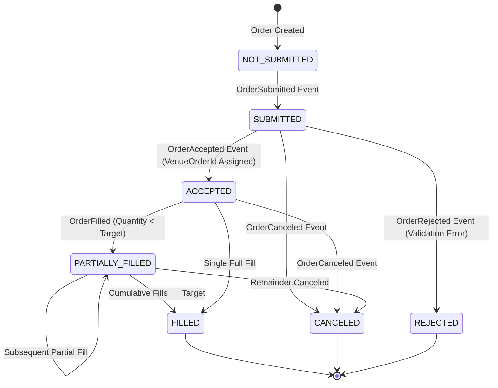
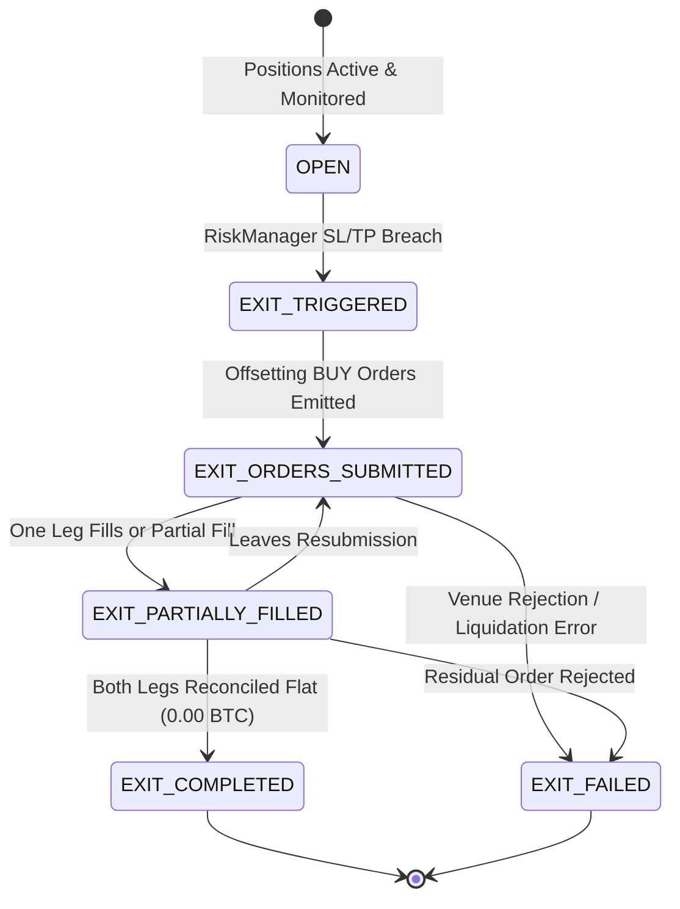

# System Architecture: BTC Options Straddle Trading Platform

This document provides a comprehensive technical breakdown of the **Mernplus Technologies BTC Options Straddle** trading engine built on **NautilusTrader 1.231.0**.

---

## 1. High-Level Architecture Overview

The platform is designed around a modular, event-driven architecture that separates exchange connectivity, instrument discovery, algorithmic decision-making, order execution, position tracking, and autonomous risk management.

```mermaid
graph TD
    subgraph Bybit_Testnet ["Bybit Testnet (Cloud Venue)"]
        WS_Linear["WebSocket: /v5/public/linear (Spot/Perp)"]
        WS_Option["WebSocket: /v5/public/option (Options)"]
        REST_API["REST API: /v5/market/instruments-info"]
        MATCH_ENG["Bybit Matching Engine"]
    end

    subgraph NT_Kernel ["NautilusTrader 1.231.0 Kernel (Rust/Cython)"]
        TradingNode["TradingNode"]
        DataEngine["DataEngine / MessageBus"]
        ExecEngine["ExecEngine"]
        RiskEngine["RiskEngine"]
        LiveClock["LiveClock / TestClock"]
    end

    subgraph Custom_Subsystems ["Straddle Engine Subsystems"]
        BybitClient["BybitTestnetClient<br/>(exchange/bybit_client.py)"]
        Discovery["BtcOptionsDiscoveryService<br/>(exchange/instrument_discovery.py)"]
        Selector["InstrumentSelector<br/>(strategy/instrument_selector.py)"]
        MarketData["MarketDataManager<br/>(exchange/market_data.py)"]
        OrderMgr["OrderManager<br/>(strategy/order_manager.py)"]
        PosTracker["PositionTracker<br/>(strategy/position_tracker.py)"]
        Calc["StraddleCalculator<br/>(utils/calculations.py)"]
        RiskMgr["RiskManager<br/>(strategy/risk_manager.py)"]
        Strategy["BtcShortStraddleStrategy<br/>(strategy/straddle_strategy.py)"]
    end

    REST_API -->|Query active chain| Discovery
    WS_Linear -->|Underlying QuoteTicks| DataEngine
    WS_Option -->|Option QuoteTicks| DataEngine
    Discovery -->|DiscoveredOptionsChain| Strategy
    DataEngine -->|QuoteTick Events| Strategy
    Strategy -->|Compute ATM min |K - S|| Selector
    Strategy -->|Validate Quotes| MarketData
    Strategy -->|Execute SELL Orders| OrderMgr
    OrderMgr -->|OrderFactory Limit SELL| ExecEngine
    ExecEngine -->|SubmitOrder Messages| MATCH_ENG
    MATCH_ENG -->|OrderAccepted / OrderFilled| ExecEngine
    ExecEngine -->|Execution Callbacks| Strategy
    Strategy -->|Apply Fills| PosTracker
    PosTracker -->|Position Snapshot| RiskMgr
    RiskMgr -->|Evaluate Buyback vs SL/TP| Calc
    RiskMgr -->|Automated Exit on SL/TP Breach| OrderMgr
    OrderMgr -->|OrderFactory BUY Market / Aggressive Limit| ExecEngine
```

---

## 2. Core Subsystems & Responsibilities

### 2.1 Exchange Layer (`exchange/`)
- **`BybitTestnetClient`**: Wraps NautilusTrader's `BybitDataClient` and `BybitExecClient`. Enforces `BYBIT_TESTNET=True` and rejects any live/production connection attempts via hard security assertions. Builds and initializes the `TradingNode`.
- **`BtcOptionsDiscoveryService`**: Queries Bybit V5 REST API for `baseCoin=BTC` options. Filters expired instruments, separates Calls and Puts, validates contract metadata (multiplier $1.0$, min order lot size $0.01$ BTC, price increments), and caches discovered chains.
- **`MarketDataManager`**: Subscribes to real-time `QuoteTick` data feeds. Validates quote freshness ($age < 5.0\,\text{s}$), verifies positive bid and ask prices, detects crossed orderbooks ($\text{Bid} \ge \text{Ask}$), and composes synchronized market snapshots. Strictly prohibits using Last-Traded Price (LTP) for buyback liabilities.

### 2.2 Strategy & Decision Layer (`strategy/`)
- **`InstrumentSelector`**: Solves the At-The-Money (ATM) strike minimization problem:
  $$\min_{K} |K - S_{\text{ref}}|$$
  Filters active contracts by target expiration, matches identical strikes ($K$) and expiration dates for Call and Put legs, and resolves equidistant strike ties deterministically.
- **`BtcShortStraddleStrategy`**: Inherits from NautilusTrader's `Strategy` base class. Coordinates the entire trading lifecycle via callbacks (`on_start`, `on_quote_tick`, `on_order_submitted`, `on_order_accepted`, `on_order_filled`, `on_position_changed`, `on_stop`).

### 2.3 Execution & Order Management (`strategy/order_manager.py`)
- **`OrderManager`**: Dual-leg order orchestration engine wired to NautilusTrader's Cython `OrderFactory`.
  - Generates monotonic, unique, Bybit-compliant `ClientOrderId` tags (`S-C-...` for Calls, `S-P-...` for Puts, `...-EXIT` for liquidations, `...-CLOSE` for orphan recoveries).
  - Enforces independent leg tracking with a 7-state finite state machine per leg.
  - Computes volume-weighted average fill prices (VWAP) and tracks cumulative commissions.
  - Implements orphan leg detection (`is_one_leg_filled`) and executes the configurable `CANCEL_AND_CLOSE` recovery policy.
  - Coordinates automated liquidation through a 6-state exit execution engine (`StraddleExitExecution`).

### 2.4 Accounting & Position Tracking (`strategy/position_tracker.py`)
- **`PositionTracker`**: Maintains granular position accounting for each straddle leg.
  - Tracks open quantities, average entry VWAP, side, and realized/unrealized PnL.
  - Implements ask-side mark-to-market valuation (valuing short liabilities by the actual cost to buy them back).
  - Reconciles with native NautilusTrader `Position` domain events.
  - Provides empirical verification of flat status (`is_flat == True`).

### 2.5 Calculations & Risk Management (`utils/calculations.py` & `strategy/risk_manager.py`)
- **`StraddleCalculator`**: High-precision arithmetic library utilizing Python's `Decimal` type to prevent binary floating-point representation drift. Computes entry premiums, SL thresholds (+1.0%), TP thresholds (-2.0%), current buyback values, and PnL percentages.
- **`RiskManager`**: Real-time risk watchdog.
  - Remains `DISARMED` until both entry fills confirm an active two-leg short straddle.
  - Evaluates live buyback liability on every validated quote tick.
  - Raises `RiskTriggerEvent` when $\text{Buyback} \ge \text{SL\_THRESHOLD}$ or $\text{Buyback} \le \text{TP\_THRESHOLD}$.
  - Prevents race conditions and duplicate exit triggers through an atomic idempotency lock.
  - Automatically dispatches closing BUY orders via `OrderManager.initiate_straddle_exit()`.

---

## 3. Order Lifecycle State Machines

### 3.1 Individual Leg Entry State Machine
Each individual option leg progresses through a 7-state execution lifecycle:



### 3.2 Dual-Leg Straddle Exit State Machine
Automated position closure follows a strict 6-state progression:



---

## 4. Concurrency & Threading Architecture

NautilusTrader combines high-speed native Rust kernels with an asynchronous Python runtime:

1. **Rust / Cython Message Bus**: Handles microsecond-latency event dispatching for `QuoteTick`, `OrderSubmitted`, `OrderAccepted`, `OrderFilled`, and `PositionChanged` events.
2. **Asyncio Event Loop**: Manages non-blocking WebSocket I/O, REST request dispatching, and background diagnostic tasks.
3. **Thread Safety & Idempotency**:
   - `OrderManager` tracks event IDs to deduplicate retransmitted WebSocket packets.
   - `RiskManager` employs an atomic boolean gate (`is_exit_in_progress`) to prevent rapid quote tick bursts from spawning duplicate exit orders.
   - `QuoteTick` precision alignment guarantees Cython numerical stability across all internal pricing operations.
