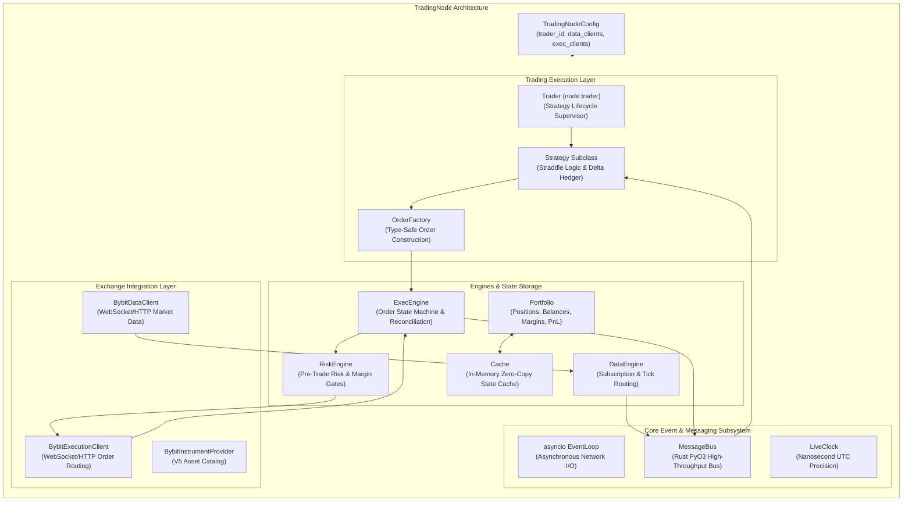

# NautilusTrader Architectural Research & Technical Specification

## Overview
This document provides a comprehensive technical breakdown of **NautilusTrader 1.231.0** architecture, based on verified inspection of the installed binaries, class definitions, and source modules.

---

## 1. TradingNode Architecture

`TradingNode` is the top-level orchestration container in NautilusTrader for running live, event-driven trading systems. It unifies asynchronous I/O, nanosecond message routing, in-memory caching, execution reconciliation, and risk validation into a single resilient process.

### 1.1. Core Architectural Components



### 1.2. Component Responsibilities
- **`TradingNode`** (`nautilus_trader.live.node.TradingNode`):
  - Initializes engines, message buses, and thread executors.
  - Manages client factories via `add_data_client_factory` and `add_exec_client_factory`.
  - Coordinates multi-stage initialization: `build()`, `run()`, `stop()`, `dispose()`.
- **`Trader`** (`nautilus_trader.trading.trader.Trader`, accessible via `node.trader`):
  - Manages strategy instances (`add_strategy`, `start_strategy`, `stop_strategy`).
  - Handles global emergency shutdowns and residual position checking.
- **`DataEngine`** (`nautilus_trader.data.engine.DataEngine`):
  - Handles venue registration, data subscription multiplexing, and event distribution.
- **`ExecEngine`** (`nautilus_trader.execution.engine.ExecutionEngine`):
  - Manages the lifecycle of orders (`PENDING_SUBMIT`, `SUBMITTED`, `ACCEPTED`, `FILLED`, `CANCELED`).
  - Maintains strict state parity between exchange reports and local portfolio memory.
- **`Portfolio`** (`nautilus_trader.portfolio.portfolio.Portfolio`):
  - Real-time aggregation of balances, margins, and unrealized/realized PnL.
- **`Cache`** (`nautilus_trader.cache.cache.Cache`):
  - In-memory database of all loaded instruments, orders, positions, and ticks.

---

## 2. TradingNode Lifecycle & Sequence

### 2.1. Initialization Sequence
```python
from nautilus_trader.live.node import TradingNode
from nautilus_trader.config import TradingNodeConfig
from nautilus_trader.adapters.bybit.factories import (
    BybitLiveDataClientFactory,
    BybitLiveExecClientFactory,
)

# 1. Instantiate TradingNodeConfig
node_config = TradingNodeConfig(
    trader_id="STRADDLE-BOT-01",
    data_clients={"BYBIT": bybit_data_config},
    exec_clients={"BYBIT": bybit_exec_config},
    timeout_connection=15.0,
    timeout_reconciliation=10.0,
)

# 2. Instantiate TradingNode
node = TradingNode(config=node_config)

# 3. Register Client Factories
node.add_data_client_factory("BYBIT", BybitLiveDataClientFactory)
node.add_exec_client_factory("BYBIT", BybitLiveExecClientFactory)

# 4. Build Internal Engines and Clients
node.build()

# 5. Add Strategy to Node Trader
node.trader.add_strategy(my_straddle_strategy)

# 6. Run the Event Loop (Blocking or Async)
node.run()
```

### 2.2. Shutdown Sequence
When `node.stop()` or `SIGINT` occurs:
1. `node.trader.stop_strategy(strategy.id)`: Calls `strategy.on_stop()`.
2. Cancels all in-flight asynchronous tasks.
3. Execution client executes disconnect sequence: closes WebSocket sessions, drains outbound queues.
4. Data client unsubscribes from ticker/book channels and disconnects.
5. In-memory state and thread pools are released via `node.dispose()`.

---

## 3. The `Strategy` Base Class

All algorithmic logic inherits from `nautilus_trader.trading.strategy.Strategy`.

### 3.1. Verified Strategy Lifecycle Callbacks
```python
from nautilus_trader.trading.strategy import Strategy
from nautilus_trader.model.instruments import Instrument
from nautilus_trader.model.data import QuoteTick, TradeTick, OrderBook, OptionGreeks
from nautilus_trader.model.events import (
    OrderSubmitted,
    OrderAccepted,
    OrderRejected,
    OrderCanceled,
    OrderFilled,
    PositionOpened,
    PositionChanged,
    PositionClosed,
)

class BtcStraddleBase(Strategy):
    def on_start(self) -> None:
        """Invoked when the strategy starts. Subscribe to market feeds here."""
        self.log.info("Strategy starting...")

    def on_stop(self) -> None:
        """Invoked on shutdown. Cancel orders and close positions here."""
        self.cancel_all_orders(self.instrument_id)

    def on_instrument(self, instrument: Instrument) -> None:
        """Invoked when a newly requested instrument is loaded into memory."""
        pass

    def on_quote_tick(self, tick: QuoteTick) -> None:
        """Invoked on every incoming top-of-book quote (bid/ask)."""
        pass

    def on_option_greeks(self, option_greeks: OptionGreeks) -> None:
        """Invoked when venue broadcasts live delta, gamma, vega, theta, and IV."""
        pass

    def on_order_filled(self, event: OrderFilled) -> None:
        """Invoked on order fill execution reports."""
        pass

    def on_position_opened(self, event: PositionOpened) -> None:
        """Invoked when a new position is established."""
        pass

    def on_position_changed(self, event: PositionChanged) -> None:
        """Invoked when an existing position size changes."""
        pass

    def on_position_closed(self, event: PositionClosed) -> None:
        """Invoked when a position is completely flattened."""
        pass
```

---

## 4. Market Data Subscriptions & Event Streams

NautilusTrader strategies interact with data clients using declarative subscription methods:

| Subscription Method | Event Received | Strategy Handler | Bybit V5 Topic |
| :--- | :--- | :--- | :--- |
| `subscribe_quote_ticks(instrument_id)` | `QuoteTick` | `on_quote_tick(self, tick)` | `tickers.{symbol}` |
| `subscribe_trade_ticks(instrument_id)` | `TradeTick` | `on_trade_tick(self, tick)` | `publicTrade.{symbol}` |
| `subscribe_order_book_at_interval(instrument_id, depth, interval_ms)` | `OrderBook` | `on_order_book(self, order_book)` | `orderbook.{depth}.{symbol}` |
| `subscribe_option_greeks(instrument_id)` | `OptionGreeks` | `on_option_greeks(self, greeks)` | `tickers.{symbol}` (category=option) |

---

## 5. Order Construction & OrderFactory

Orders must be created via the strategy's built-in `self.order_factory` (`nautilus_trader.common.factories.OrderFactory`). This guarantees deterministic client order IDs, tags, strategy IDs, and risk compliance.

### 5.1. Verified Order Creation Patterns
```python
# Limit Order Construction
call_order = self.order_factory.limit(
    instrument_id=call_instrument_id,
    order_side=OrderSide.BUY,
    quantity=Quantity.from_str("0.1"),
    price=Price.from_str("0.0450"),
    time_in_force=TimeInForce.GTC,
    post_only=False,
)

# Market Order Construction (e.g. for dynamic perpetual hedge)
hedge_order = self.order_factory.market(
    instrument_id=perp_instrument_id,
    order_side=OrderSide.SELL,
    quantity=Quantity.from_str("0.05"),
)

# Order Submission to ExecEngine
self.submit_order(call_order)
self.submit_order(hedge_order)
```

---

## 6. Position Tracking & Portfolio Queries

Positions are automatically tracked in memory across state transitions.

### 6.1. Strategy Accessors
- `self.portfolio.positions()`: Returns all open positions across instruments.
- `self.portfolio.position(instrument_id: InstrumentId)`: Returns the current `Position` for a specific contract (`position.quantity`, `position.side`, `position.realized_pnl`, `position.unrealized_pnl`).
- `self.portfolio.account(venue: Venue)`: Queries account balances, total equity, initial margin, and maintenance margin.
- `self.close_position(position)`: Generates and submits an offsetting market order to instantly flatten the specified position.
