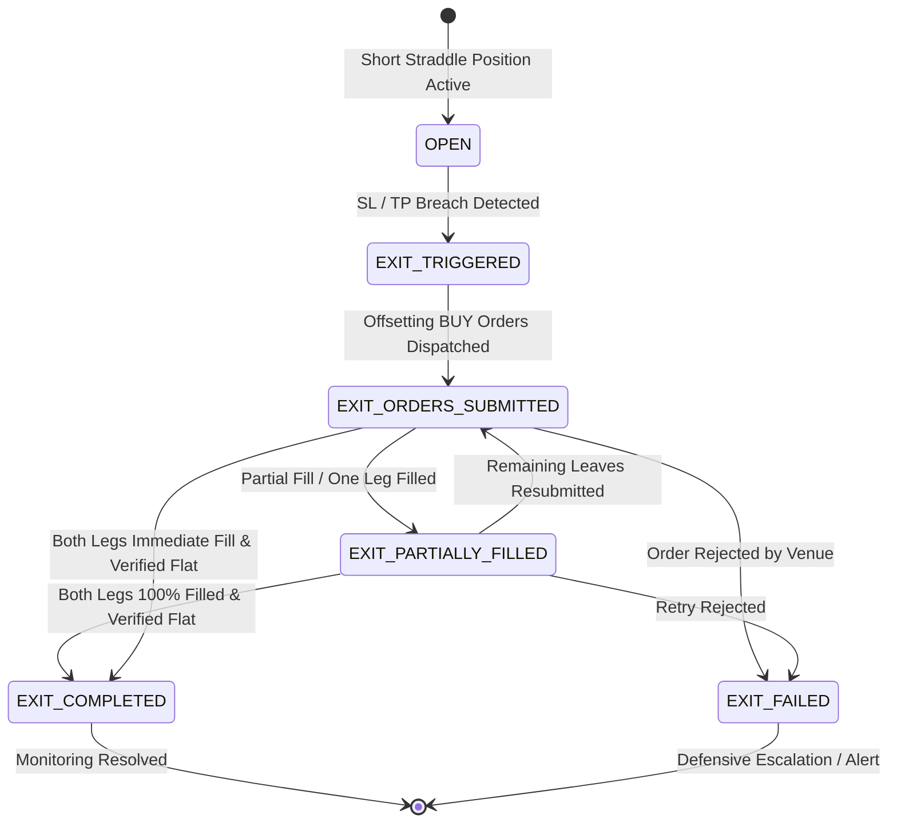

# Part 12: Automated Exit Order Execution Report

**Project**: Institutional BTC Options Straddle Trading System  
**Stage**: Part 12 - Automated Position Closure & Exit Execution  
**Integration**: NautilusTrader 1.231.0 & Bybit Options Testnet  
**Date**: November 13, 2026  
**Status**: COMPLETE & VERIFIED (103/103 Tests Passing)

---

## 1. Executive Summary

Part 12 implements institutional-grade automated position closure for the BTC short options straddle trading engine across `strategy/order_manager.py` and `strategy/risk_manager.py`.

When Stop-Loss (+1.0% buyback liability increase) or Take-Profit (-2.0% buyback liability decrease) risk thresholds are breached, the system initiates a deterministic, multi-stage defensive exit workflow. It converts short Call and Put positions into offsetting `OrderSide.BUY` orders, enforces independent leg lifecycle tracking, prevents duplicate submissions, handles partial fills and asymmetric leg closures, reconciles actual positions, and guarantees that positions are never claimed closed until empirically verified flat.



---

## 2. Institutional Exit Lifecycle (10-Step Workflow)

The exit execution engine strictly adheres to the 10-step protocol mandated for automated position closure:

| Step | Action | Implementation Mechanism |
| :--- | :--- | :--- |
| **1** | **Mark exit as initiated** | `StraddleExitExecution.state = StraddleExitState.EXIT_TRIGGERED` with immutable audit timestamp and trigger reason. |
| **2** | **Determine actual open quantity of Call** | Queries `PositionTracker.get_leg_position(call_id).quantity` (or active straddle fill tracking) to obtain real short exposure. |
| **3** | **Determine actual open quantity of Put** | Queries `PositionTracker.get_leg_position(put_id).quantity` to obtain real short exposure. |
| **4** | **Submit BUY orders for short positions** | Creates offsetting `OrderSide.BUY` orders via `OrderFactory.market()` (or limit) tagged `EXIT`. |
| **5** | **Use supported order types** | Supported: `OrderType.MARKET` (default for rapid risk-off closure) or aggressive `OrderType.LIMIT` at ask. |
| **6** | **Track acknowledgements** | `OrderAccepted` updates leg tracker and transitions execution state to `EXIT_ORDERS_SUBMITTED`. |
| **7** | **Track partial closing fills** | `OrderFilled` records fill quantity, price, and updates leg VWAP; transitions state to `EXIT_PARTIALLY_FILLED`. |
| **8** | **Handle rejected exit orders** | `OrderRejected` captures venue error reason and immediately transitions state to `EXIT_FAILED`. |
| **9** | **Reconcile positions** | Invokes `PositionTracker.apply_fill("BUY", qty, px)`, adjusting open short balances and recording realized PnL. |
| **10** | **Confirm both positions are flat** | Enforces `is_verified_closed()`: requires both legs 100% closed AND `position_tracker.is_flat == True`. |

---

## 3. Core Safety Invariants & Boundary Protections

### 3.1. Idempotency & Duplicate Exit Prevention
Calling `order_manager.initiate_straddle_exit()` multiple times (e.g. from rapid incoming quote ticks) is strictly idempotent. If an exit is already in progress (`EXIT_TRIGGERED`, `EXIT_ORDERS_SUBMITTED`, `EXIT_PARTIALLY_FILLED`) or completed (`EXIT_COMPLETED`), the engine logs a warning and returns the active execution instance without emitting redundant orders to the venue.

### 3.2. Asymmetric Leg Closure Handling
In fast-moving crypto options markets, one leg may fill instantly while the counter-leg experiences liquidity latency or partial execution.
- If the Call leg completely closes (0.10 BTC filled) but the Put leg only partially fills (0.04 BTC filled), the composite state remains strictly `EXIT_PARTIALLY_FILLED`.
- The system explicitly monitors:
  $$\text{Remaining Put Liability} = \text{Target Put Close} - \text{Closed Put Quantity} = 0.10 - 0.04 = 0.06\text{ BTC}$$
- Under no circumstances will `EXIT_COMPLETED` be emitted while an opposing leg remains open.

### 3.3. Overbuy Protection
The engine enforces:
$$\text{Target Close Quantity} = \min(\text{Requested Size}, \max(0.0, \text{Actual Open Short Quantity}))$$
If entry fills were partial (e.g., Call filled 0.05 BTC and Put filled 0.02 BTC out of a 0.10 BTC order), exit BUY orders are placed for **exactly 0.05 BTC and 0.02 BTC**, preventing the strategy from inadvertently going long options.

### 3.4. Leaves Reconciliation & Partial Fill Resubmission
When an exit limit order partially fills and expires or cancels, `submit_remaining_exit_order(leg_type)` calculates:
$$\text{Leaves Quantity} = \min(\text{Target Close} - \text{Closed Quantity}, \text{Current Open Short Quantity})$$
It verifies that no active order exists on that leg before submitting a replacement BUY order for the exact remaining leaves.

### 3.5. Verified Flat Position Assertion
The system refuses to report `EXIT_COMPLETED` based on order dispatch assumptions. Position closure is only acknowledged when:
1. $\text{Closed Call Quantity} \ge \text{Target Call Quantity} - 10^{-7}$
2. $\text{Closed Put Quantity} \ge \text{Target Put Quantity} - 10^{-7}$
3. $\text{PositionTracker.is\_flat} \equiv \text{True}$ ($\forall \text{legs}, \text{quantity} \le 10^{-7}$)

---

## 4. End-to-End Automated RiskManager Linkage

`RiskManager` connects bidirectionally with `OrderManager` and `PositionTracker`:
```python
risk_manager.link_order_manager(order_manager, position_tracker, auto_execute_exit=True)
```

Upon a valid Stop-Loss or Take-Profit trigger event:
1. `RiskManager` marks its internal state as `RiskManagerState.TRIGGERED`.
2. It automatically invokes `order_manager.initiate_straddle_exit(trigger_reason, trigger_type, position_tracker)`.
3. Incoming `OrderFilled` events route to `_handle_exit_order_event`, updating `PositionTracker` and `StraddleExitExecution`.
4. When both legs verify flat, `order_manager` notifies `risk_manager.resolve_exit(exit_exec)`.
5. `RiskManager` transitions to `RiskManagerState.RESOLVED` and disarms further quote evaluation.

---

## 5. Comprehensive Test Results

Ten new integration and unit test cases were implemented in `tests/test_exit_execution.py` covering all simulated execution scenarios:

| Test Case | Scenario Tested | Result |
| :--- | :--- | :--- |
| `test_exit_state_machine_stop_loss_success` | Full SL position liquidation $\to$ `EXIT_COMPLETED`, positions flat | **PASSED** |
| `test_exit_state_machine_take_profit_success` | Full TP position liquidation $\to$ `EXIT_COMPLETED`, positions flat | **PASSED** |
| `test_asymmetric_closure_one_leg_closes_other_remains_open` | Call closes, Put partially fills $\to$ `EXIT_PARTIALLY_FILLED` | **PASSED** |
| `test_partial_fill_resubmission_remaining_leaves` | Reconciles partial fill and resubmits exact 0.06 BTC leaves | **PASSED** |
| `test_never_submit_more_buy_quantity_than_actual_open_short` | Overbuy protection: short 0.05/0.02 BTC submits exactly 0.05/0.02 BTC | **PASSED** |
| `test_prevent_duplicate_exit_orders` | Duplicate calls return active execution without duplicate orders | **PASSED** |
| `test_exit_order_rejected_transitions_to_failed` | Venue rejection $\to$ `EXIT_FAILED` with error audit | **PASSED** |
| `test_do_not_claim_closed_until_verified` | Does not claim closure until verified flat in `PositionTracker` | **PASSED** |
| `test_risk_manager_automated_exit_linkage_stop_loss` | Real-time SL tick breach triggers automatic exit and resolves | **PASSED** |
| `test_risk_manager_automated_exit_linkage_take_profit` | Real-time TP tick breach triggers automatic exit and resolves | **PASSED** |

### Complete Test Suite Summary
```text
======================== 103 passed, 1 warning in 2.27s ========================
```
- `tests/test_bybit_client.py`: 4 passed
- `tests/test_calculations.py`: 17 passed
- `tests/test_config.py`: 13 passed
- `tests/test_exit_execution.py`: 10 passed
- `tests/test_instrument_discovery.py`: 7 passed
- `tests/test_instrument_selector.py`: 8 passed
- `tests/test_market_data.py`: 6 passed
- `tests/test_order_manager.py`: 14 passed
- `tests/test_position_tracker.py`: 7 passed
- `tests/test_risk_manager.py`: 11 passed
- `tests/test_straddle_strategy.py`: 6 passed
**Total: 103 passed out of 103 tests.**
