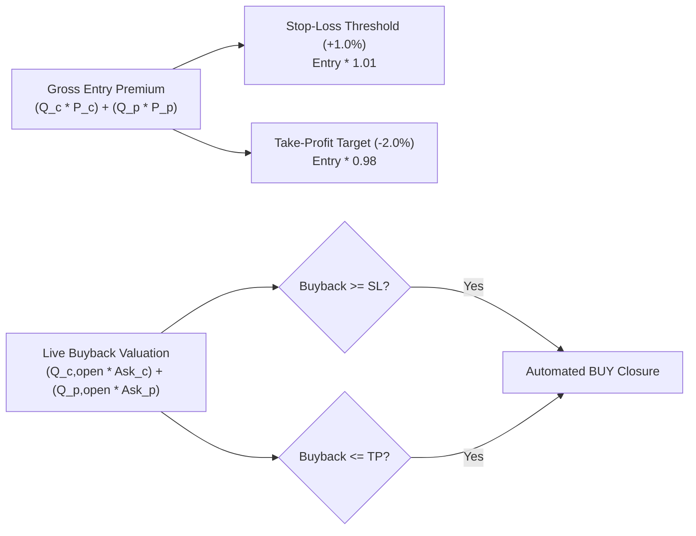

# Risk Management Engine: BTC Options Straddle Trading Platform

This document describes the mathematical foundations, risk controls, quote validation rules, and automated liquidation mechanics implemented in the **BTC Short Straddle Trading System**.

---

## 1. Mathematical Formulas & Valuation Equations

To prevent floating-point representation drift (e.g. `0.1 + 0.2 = 0.30000000000000004`), all financial values, premiums, and thresholds are computed using Python's `Decimal` type with fixed rounding.



### 1.1 Gross Entry Premium
The total premium received upon opening both legs of the short straddle:

$$\text{ENTRY\_PREMIUM} = (Q_C \times \text{VWAP}_C \times M) + (Q_P \times \text{VWAP}_P \times M)$$

Where:
- $Q_C, Q_P$: Actual executed fill quantities in BTC (not requested quantities).
- $\text{VWAP}_C, \text{VWAP}_P$: Volume-weighted average execution prices in USDT.
- $M$: Contract Multiplier ($1.0$ for Bybit BTC options).

### 1.2 Stop-Loss Threshold (+1.0% Liability Expansion)
A short straddle incurs a loss when the cost to buy back the contracts exceeds the premium collected. The Stop-Loss triggers when liability rises by **$1.0\%$**:

$$\text{SL\_THRESHOLD} = \text{ENTRY\_PREMIUM} \times \left(1 + \frac{\text{STOP\_LOSS\_PERCENT}}{100}\right) = \text{ENTRY\_PREMIUM} \times 1.01$$

*Example: If $\text{ENTRY\_PREMIUM} = \$248.00$, then $\text{SL\_THRESHOLD} = 248.00 \times 1.01 = \$250.48$.*

### 1.3 Take-Profit Target (-2.0% Liability Contraction)
The strategy takes profit when theta decay or volatility crush reduces the buyback liability by **$2.0\%$**:

$$\text{TP\_THRESHOLD} = \text{ENTRY\_PREMIUM} \times \left(1 - \frac{\text{TAKE\_PROFIT\_PERCENT}}{100}\right) = \text{ENTRY\_PREMIUM} \times 0.98$$

*Example: If $\text{ENTRY\_PREMIUM} = \$248.00$, then $\text{TP\_THRESHOLD} = 248.00 \times 0.98 = \$243.04$.*

### 1.4 Live Buyback Valuation
The live cost to liquidate the entire short straddle at current market prices:

$$\text{CURRENT\_BUYBACK\_VALUE} = (Q_{C,\text{open}} \times \text{ASK}_C \times M) + (Q_{P,\text{open}} \times \text{ASK}_P \times M)$$

Where $\text{ASK}_C$ and $\text{ASK}_P$ are the best ask prices currently available in the Bybit orderbook.

### 1.5 Unrealized Mark-to-Market Profit & Loss
$$\text{UNREALIZED\_PNL} = \text{ENTRY\_PREMIUM} - \text{CURRENT\_BUYBACK\_VALUE}$$
$$\text{PNL\_PERCENTAGE} = \frac{\text{UNREALIZED\_PNL}}{\text{ENTRY\_PREMIUM}} \times 100\%$$

### 1.6 Realized Profit & Loss (Post-Liquidation)
$$\text{REALIZED\_PNL} = \text{ENTRY\_PREMIUM} - \text{TOTAL\_EXIT\_COST} - \sum \text{FEES}$$

---

## 2. Market Data Hygiene & Quote Validation Rules

The `MarketDataManager` and `RiskManager` enforce strict data filtering to prevent false triggers resulting from stale data or illiquid market anomalies.

| Validation Check | Rejection Condition | Engine Action | Risk Rationale |
| :--- | :--- | :--- | :--- |
| **Quote Freshness** | $\text{Timestamp}_{\text{now}} - \text{Timestamp}_{\text{quote}} > 5.0\,\text{s}$ | Discard quote; do not trigger SL/TP | Stale quotes do not reflect executable liquidity. |
| **Crossed Orderbook** | $\text{Bid} \ge \text{Ask}$ | Log warning; drop quote tick | Indicates exchange match engine backlog or bad data feed. |
| **Non-Positive Prices** | $\text{Bid} \le 0$ or $\text{Ask} \le 0$ | Drop quote tick | Zero or negative prices are invalid for options orderbooks. |
| **Incomplete Pair** | One leg has no active quote | Maintain previous valuation; do not trigger | Unilateral leg valuation distorts straddle liability. |
| **LTP Prohibition** | Using Last-Traded Price (LTP) | **STRICTLY FORBIDDEN** | LTP represents historical trades. Liquidation requires buying at the **current Ask**. |

---

## 3. Orphan Leg Recovery Policies

When submitting dual entry orders, market conditions may cause one leg to fill while the opposing leg remains pending or gets rejected:

```
Scenario: Call = FILLED (0.05 BTC), Put = PENDING (0.00 BTC Filled)
```

The system recognizes this condition via `StraddleOrder.is_one_leg_filled` and activates the configured `UnmatchedLegPolicy`:

1. **`CANCEL_AND_CLOSE` (Default & Recommended)**:
   - Immediately cancels the pending Put order.
   - Generates an offsetting BUY order for the filled Call leg to buy back and neutralize exposure.
   - Restores the account to a verified flat state.
2. **`CANCEL_REMAINING`**:
   - Cancels the pending order, leaving the filled single leg open as a naked option.
3. **`WAIT`**:
   - Awaits the arrival of the second leg fill until the `ENTRY_TIMEOUT_SECONDS` (10.0s) expires.

---

## 4. Exit Execution & Leaves Reconciliation Engine

Automated position liquidation is governed by `StraddleExitExecution` in `strategy/order_manager.py`.

### 4.1 Strict Exit State Machine
$$\text{OPEN} \longrightarrow \text{EXIT\_TRIGGERED} \longrightarrow \text{EXIT\_ORDERS\_SUBMITTED} \longrightarrow \text{EXIT\_PARTIALLY\_FILLED} \longrightarrow \text{EXIT\_COMPLETED}$$
*(If venue rejects: $\longrightarrow \text{EXIT\_FAILED}$)*

### 4.2 Leaves Calculation & Over-Buy Prevention
To prevent over-buying beyond the actual open short position:

$$\text{Target Close Quantity} = Q_{\text{open short}}$$
$$\text{Executed Close Quantity} = \sum Q_{\text{exit fills}}$$
$$\text{Leaves Quantity} = \text{Target Close Quantity} - \text{Executed Close Quantity}$$

If a closing order fills partially (e.g., $0.04$ BTC filled out of $0.10$ BTC target), the system:
1. Calculates exactly $\text{Leaves} = 0.10 - 0.04 = 0.06$ BTC.
2. Submits a replacement exit order for **exactly $0.06$ BTC**.
3. Re-evaluates until `PositionTracker.is_flat` confirms $0.00$ BTC remaining.

---

## 5. Concurrency & Idempotency Controls

1. **Atomic Exit Lock (`is_exit_in_progress`)**: When the RiskManager triggers an exit, the lock is engaged immediately. Any subsequent quotes arriving within milliseconds are dropped with a warning:
   ```text
   Exit already in progress for straddle 'STRADDLE-...'. Rejecting duplicate exit initiation.
   ```
2. **Monotonic Order IDs**: Each exit order receives a unique monotonic identifier tagged `-EXIT` (e.g. `S-C-562680783-0003-EXIT`).
3. **Event Idempotency**: Venue execution messages retransmitted across WebSockets are deduplicated by checking `event_id` against recorded event logs.
