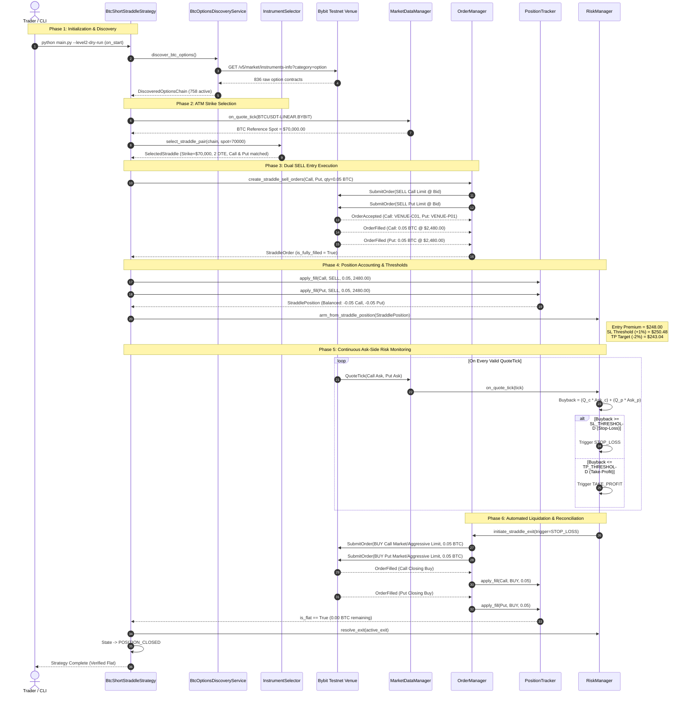

# Strategy Flow & Lifecycle: BTC Short Straddle Trading System

This document outlines the theoretical mechanics, mathematical payoff structures, and complete algorithmic lifecycle of the **BTC Short Straddle Strategy**.

---

## 1. Options Straddle Theory & Mechanics

### 1.1 What is a Short Straddle?
A **Short Straddle** is a market-neutral options strategy created by simultaneously selling a Call option and a Put option with the **identical strike price ($K$)** and the **identical expiration date ($T$)**:

$$\text{Strategy Composition} = \text{SELL 1 Call}(K, T) + \text{SELL 1 Put}(K, T)$$

```
Payoff ($)
    ^
    |          /\ (Maximum Profit = Combined Premium Collected)
    |         /  \
----+--------/----\--------> Underlying BTC Spot Price ($)
    |       /  |   \
    |      /   K    \
    |     /          \
    |    / (Loss)     \ (Loss)
    v
```

### 1.2 Greeks & Risk Profile at Initiation
- **Delta ($\Delta \approx 0$)**: At-The-Money Call delta is $\approx +0.50$; Short Call delta is $\approx -0.50$. At-The-Money Put delta is $\approx -0.50$; Short Put delta is $\approx +0.50$. Net position delta is approximately **$0.00$ (Delta Neutral)**.
- **Theta ($\Theta > 0$)**: Positive time decay. Every day that passes without significant underlying price movement increases the profit of the position as option premiums decay toward zero.
- **Vega ($\nu < 0$)**: Negative volatility exposure. The strategy profits when implied volatility (IV) contracts and suffers when IV expands.
- **Gamma ($\Gamma < 0$)**: Negative gamma exposure. Large sudden moves in either direction cause the position delta to drift rapidly away from neutral, creating expanding liability.

---

## 2. End-to-End Strategy Sequence Diagram



---

## 3. Detailed Step-by-Step Lifecycle Execution

### Step 1: Initialization & Environment Validation
- Instantiates `TradingNode`, Cython `LiveClock`, and `OrderFactory`.
- Validates configuration parameters.
- Asserts `BYBIT_TESTNET=True`.

### Step 2: Options Chain Discovery & Filtering
- Queries Bybit REST API for active options.
- Discards expired contracts (`expiration_ns <= now_ns`).
- Groups contracts by expiration date and validates that lot sizes meet the $0.01$ BTC minimum.

### Step 3: Underlying Spot Ingestion & ATM Selection
- Ingests real-time underlying reference price from `BTCUSDT-LINEAR.BYBIT`.
- Solves $\min |K - S|$ across available strikes for the target expiration.
- Validates that both the Call and Put exist, have identical strikes and expiries, and are actively trading.

### Step 4: Quote Freshness & Spread Verification
- Subscribes to real-time WebSocket feeds for selected Call and Put legs.
- Validates quote freshness ($age < 5.0\,\text{s}$).
- Verifies positive bid and ask prices ($\text{Bid} > 0, \text{Ask} > 0$) and non-inverted orderbooks ($\text{Bid} < \text{Ask}$).

### Step 5: Dual Limit SELL Order Generation
- Constructs dual SELL Limit orders at current Bid prices using `OrderFactory`.
- Assigns monotonic `ClientOrderId` strings.
- Submits orders via `OrderManager`. Enforces invariant: **Order submission $\ne$ execution.**

### Step 6: Fill Processing & VWAP Calculation
- Awaits venue execution confirmations.
- Updates cumulative fill quantities and volume-weighted average prices:
  $$\text{VWAP} = \frac{\sum (\text{Fill Quantity}_i \times \text{Fill Price}_i)}{\sum \text{Fill Quantity}_i}$$
- Tracks individual commissions and trade IDs.

### Step 7: Risk Manager Arming & Threshold Definition
- Requires both Call and Put positions to be confirmed open in `PositionTracker`.
- Calculates gross entry premium: $\text{Entry} = (Q_C \times P_C) + (Q_P \times P_P)$.
- Establishes exact mathematical thresholds:
  - Stop-Loss: $\text{SL\_THRESHOLD} = \text{Entry} \times 1.01$ (+1.0% liability increase)
  - Take-Profit: $\text{TP\_THRESHOLD} = \text{Entry} \times 0.98$ (-2.0% liability decrease)

### Step 8: Continuous Mark-to-Market Monitoring
- Streams incoming ask quotes for both options legs.
- Evaluates live buyback cost:
  $$\text{CURRENT\_BUYBACK\_VALUE} = (Q_{C,\text{open}} \times \text{Ask}_C) + (Q_{P,\text{open}} \times \text{Ask}_P)$$
- **Strict Rule**: Mark-to-market strictly uses the **ASK price** (the price to buy back short options). LTP and mid-prices are strictly prohibited.

### Step 9: Risk Breach & Automated Liquidation
- If $\text{Buyback} \ge \text{SL\_THRESHOLD}$ or $\text{Buyback} \le \text{TP\_THRESHOLD}$:
  - Raises `RiskTriggerEvent`.
  - Sets exit state to `EXIT_TRIGGERED`.
  - Locks against duplicate triggers.
  - Queries `PositionTracker` for actual open short quantities.
  - Generates offsetting BUY orders sized exactly to open positions.

### Step 10: Leaves Reconciliation & Flat Verification
- As fills arrive, computes remaining leaves: $\text{Leaves} = Q_{\text{target}} - Q_{\text{filled}}$.
- Resubmits residual orders if a leg partially fills.
- When all closing fills arrive, queries `PositionTracker.is_flat`.
- Transitions strategy state to `POSITION_CLOSED`.
- Logs final realized PnL and executes clean shutdown.
